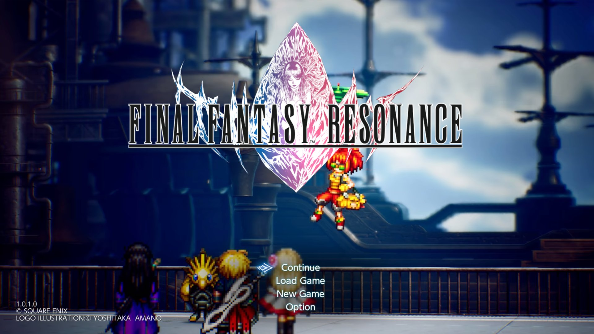
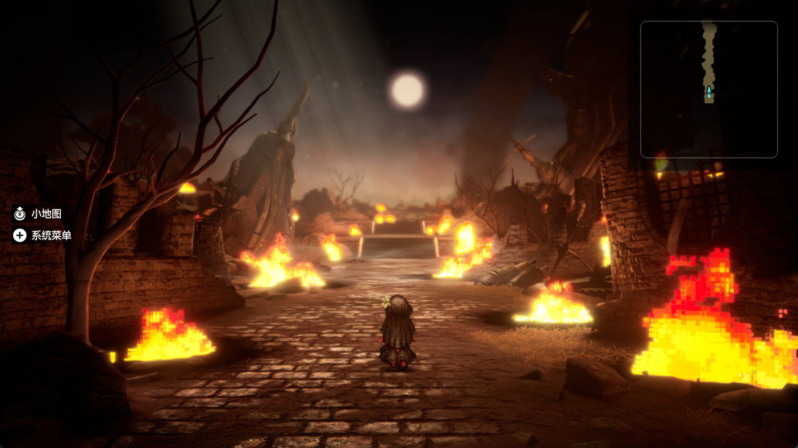

# FINAL FANTASY RESONANCE on Mac

[English](README.md) | **简体中文**

<p align="center">
  
  
</p>

在 Apple 芯片的 Mac 上原生运行 Nintendo Switch 版 FINAL FANTASY RESONANCE（亚洲版，`0100B8A026F14000`）。游戏文件和 `prod.keys` 需要你自己准备，一个脚本就能用它们构建出 Mac 应用。

这不是模拟器：游戏自身的 ARM64 代码直接在 Apple 芯片上运行，Switch 的 NVN 图形调用改在 Metal 上重建。工具链是 [nxnative](https://github.com/seedds/nxnative)，已连同本游戏需要的修复一起放在 [`nxnative/`](nxnative/) 里。

**除上面两张截图外，本仓库不包含、也不分发任何游戏内容**：没有游戏程序、美术、文字、音频、着色器、存档或密钥。

## 状态

| | |
|---|---|
| 游戏 | 亚洲版 1.0.1（v65536），main 构建 `b7f965b9d7227db8e29f04e84ea7331b`，Unreal Engine 5.6.1。语言：简体中文、繁体中文、韩语 |
| 测试环境 | Apple M5 Max，128 GB，macOS 27.0 |
| 进度 | 开场 Battlefield 和第一章可以玩；还没有完整通关 |
| 帧率 | 59.80 fps（游戏上限 60 fps）；帧时间 p50/p95/p99 为 16.71/17.48/17.95 ms，GPU p50 5.51 ms |
| 音频 | 六声道输出，长时间测量没有欠载 |
| 本仓库已修复 | 光柱和地面阴影闪烁；火焰和余烬缺失；道路上的黑色椭圆（[详情](docs/graphics-fixes.md)） |
| 未解决 | 8 个使用图像原子操作的计算着色器还没有翻译（目前没看到影响）；M5 Max 以外的芯片没有测试过（[已知问题](docs/known-issues.md)） |

不支持游戏的其他版本：针对本游戏的改动都绑定在上面的构建 ID 上。

## 安装

**用 AI 代理（最省事）**。用 Claude Code、Codex、Cursor 或类似的代理打开本仓库，对它说：“读 AGENTS.md，帮我把游戏构建出来。”它问起时，告诉它游戏文件和 `prod.keys` 的路径。[AGENTS.md](AGENTS.md) 会带它检查 Mac 环境、识别你的文件，并把构建一直跑完。

**手动安装**。按 [docs/install.md](docs/install.md) 装好依赖，然后运行：

```sh
python3 build_app.py "<你的游戏>.xci" -k "<路径>/prod.keys"
```

在 M5 Max 上首次构建约 85 分钟，大部分时间花在编译着色器上。请让它跑完；如果中途被打断，重新运行同一条命令即可，已完成的步骤会直接复用。

## 文档

以下文档均为英文。

| 页面 | 内容 |
|---|---|
| [docs/install.md](docs/install.md) | 依赖、拆分 XCI、构建、运行、操作按键、故障排查 |
| [docs/build-specific.md](docs/build-specific.md) | 这个构建的地址和改动：内存分配器、帧率控制台变量 |
| [docs/graphics-fixes.md](docs/graphics-fixes.md) | 三个渲染问题：现象、排查过程、原因、修复 |
| [docs/performance.md](docs/performance.md) | 基线、A/B 测试结果、管线预热、60 fps 上限、渲染分辨率 |
| [docs/known-issues.md](docs/known-issues.md) | 未解决的问题，以及没有验证过的部分 |
| [nxnative/VENDORED.txt](nxnative/VENDORED.txt) | 工具链基于的上游提交，以及在其之上改动的每个文件 |

## 仓库结构

```
AGENTS.md                    给 AI 代理看的安装和仓库指南
build_app.py                 一条命令构建：XCI 或 NSP + prod.keys -> Mac 应用
nxnative/                    工具链（seedds/nxnative + 本游戏的配置和修复）
  dm/games/0100B8A026F14000/ 游戏配置：补丁、着色器表、管线清单
tools/split_xci/             把合并的 XCI 拆成本体 / 更新 / DLC 三个 NSP
tools/check_publish.py       发布前检查游戏文件、密钥和个人路径
tools/sync_nxnative.py       从本地 nxnative 检出刷新 nxnative/
bench/bench.tsv              可重复的性能测试路线
docs/                        说明文档
  screenshots/               本页的两张截图
```

## 致谢

- [nxnative](https://github.com/seedds/nxnative)（seedds）：本项目依托的整套工具链
- [d2r-mobile](https://github.com/jhaizhou-ops/d2r-mobile)：nxnative 最初采用的原生执行思路
- [MacNativeGames](https://github.com/ly05010419/MacNativeGames)：按游戏实测记录并预热管线状态的方法，以及 AI 辅助安装
- [Ryujinx](https://github.com/Ryujinx/Ryujinx)（着色器翻译器）、[LibHac](https://github.com/Thealexbarney/LibHac)，以及 [THIRD_PARTY_NOTICES.md](THIRD_PARTY_NOTICES.md) 中列出的其他组件

## 许可

[MIT](LICENSE)。第三方组件沿用各自的许可（[THIRD_PARTY_NOTICES.md](THIRD_PARTY_NOTICES.md)）。FINAL FANTASY RESONANCE 及其商标归 SQUARE ENIX 所有；本项目与 SQUARE ENIX、Nintendo 及任何发行商无关。贡献方式见 [CONTRIBUTING.md](CONTRIBUTING.md)。
